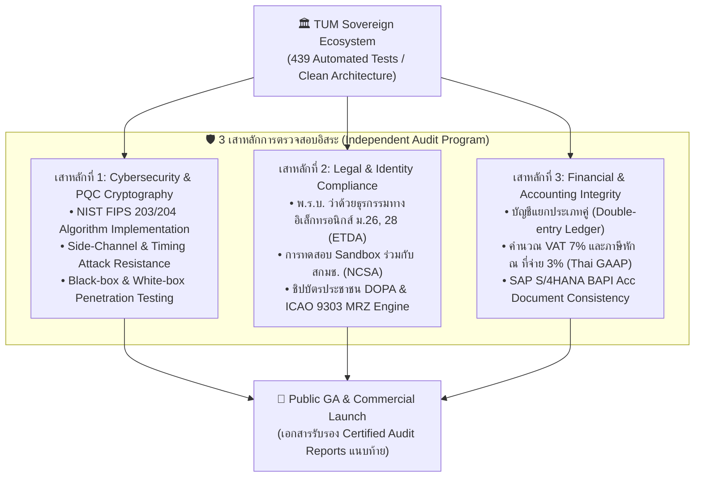

# โปรแกรมการตรวจสอบรับรองโดยหน่วยงานอิสระภายนอก (Third-Party Independent Audit & Certification Program)
## TUM Group Holdings: Sovereign Ecosystem Verification Framework
**รหัสเอกสาร:** `TUM-GOV-AUDIT-RFP-2026`  
**สถานะ:** อนุมัติตามข้อสั่งการของประธานกรรมการบริหาร (Approved by Executive Chairman)  
**เป้าหมาย:** กำหนดขอบเขตการว่าจ้างผู้ตรวจสอบภายนอก (Independent Auditors) เพื่อพิสูจน์และรับรองความถูกต้องของเทคโนโลยี ก่อนการเปิดตัวสู่สาธารณชนวงกว้าง (Zero Over-claiming Guarantee)

---

## 1. เจตนารมณ์และหลักการกำกับดูแล (Governance Principle)

> *"ความน่าเชื่อถือของโครงสร้างพื้นฐานระดับอธิปไตย (Sovereign Infrastructure) ต้องสร้างขึ้นบนพื้นฐานของการพิสูจน์ได้ทางวิทยาศาสตร์ (Evidence-Based) ปราศจากการโฆษณาเกินจริง (Zero Over-claiming) และผ่านการตรวจสอบอย่างโปร่งใสโดยผู้เชี่ยวชาญอิสระระดับสากล"*

TUM Group Holdings จะไม่ประกาศความสำเร็จสู่สาธารณะเกินกว่าผลลัพธ์ที่พิสูจน์ได้จริง โดยกำหนดให้เทคโนโลยีในทั้ง 8 Repositories ต้องผ่านการตรวจประเมินตาม **3 เสาหลักแห่งการตรวจสอบ (3 Audit Pillars)**:

---

## 2. รายละเอียดขอบเขตการว่าจ้างผู้ตรวจสอบภายนอก (Audit Scopes & Target Vendors)

### 2.1 เสาหลักที่ 1: การตรวจสอบความมั่นคงปลอดภัยไซเบอร์และการเข้ารหัสลับควอนตัม
* **ผลิตภัณฑ์เป้าหมาย:** `tum-quantum`, `tum-cybermesh`, `tum-central-director`, `tum-socs`
* **ขอบเขตการตรวจประเมิน (Scope of Work):**
  1. **NIST FIPS 203 (ML-KEM-768) & FIPS 204 (ML-DSA-65/87) Implementation:** ตรวจสอบความถูกต้องของตรรกะคณิตศาสตร์โครงตาข่าย (Lattice Math), ความปลอดภัยของแหล่งสุ่มข้อมูล (CSPRNG Entropy), และการป้องกันช่องโหว่จากการวัดเวลาหรือการใช้พลังงาน (Side-Channel & Timing Attacks)
  2. **Automated SOAR & Sentinel Interception:** ทดสอบเจาะระบบ (Penetration Test) เพื่อพิสูจน์ว่ากลไกการกักกันเครือข่ายและการดักจับ Prompt Injection / Remote Shell ทำงานได้จริงและไม่ถูก Bypass
  3. **Lakehouse WORM Immutability:** ทดสอบความคงสภาพของ Audit Trail ว่าไม่สามารถถูกแก้ไขย้อนหลังได้
* **ผู้ตรวจสอบที่แนะนำ (Target Auditors):**
  - **ระดับสากล:** *Trail of Bits* (สหรัฐฯ), *NCC Group* (สหราชอาณาจักร), หรือ *Mandiant / Google Cloud Security*
  - **ระดับประเทศ:** *ACIS Professional Center* หรือ *Mayaseven*

---

### 2.2 เสาหลักที่ 2: การตรวจสอบความสอดคล้องตามกฎหมายและอัตลักษณ์ดิจิทัลแห่งชาติ
* **ผลิตภัณฑ์เป้าหมาย:** `tum-trust-fabric`, `tum-trust-security`
* **ขอบเขตการตรวจประเมิน (Scope of Work):**
  1. **Reliable Electronic Signatures & Qualified Seals:** ตรวจสอบความสอดคล้องตามมาตรา 26 และมาตรา 28 แห่ง **พ.ร.บ. ว่าด้วยธุรกรรมทางอิเล็กทรอนิกส์ พ.ศ. 2544 (และที่แก้ไขเพิ่มเติม)** ร่วมกับสำนักงานพัฒนาธุรกรรมทางอิเล็กทรอนิกส์ (ETDA)
  2. **RFC 3161 Sovereign TSA:** ตรวจสอบความเที่ยงตรงของเวลาประทับดิจิทัลและ Merkle Audit Tree Root Anchoring
  3. **Biometric Anti-Spoofing & ICAO 9303:** ตรวจสอบความแม่นยำของอัลกอริทึม 3D Disparity ในการสกัดกั้นการใช้ภาพถ่าย/หน้ากากปลอม และการอ่านข้อมูลหนังสือเดินทางอิเล็กทรอนิกส์
* **หน่วยงานและผู้ตรวจสอบเป้าหมาย:**
  - ศูนย์ทดสอบและรับรองความสอดคล้องของ **ETDA Regulatory Sandbox**
  - ศูนย์ทดสอบความมั่นคงปลอดภัยไซเบอร์แห่งชาติ **สกมช. (NCSA)**
  - คณะทำงานร่วมด้านเทคนิค กรมการปกครอง (DOPA)

---

### 2.3 เสาหลักที่ 3: การตรวจสอบความถูกต้องทางบัญชีและภาษีอากรองค์กร
* **ผลิตภัณฑ์เป้าหมาย:** `tum-agentic-workos`
* **ขอบเขตการตรวจประเมิน (Scope of Work):**
  1. **Thai GAAP Compliance:** ตรวจสอบความถูกต้องของการบันทึกบัญชีแยกประเภทคู่ (Double-entry Journal Vouchers) เดบิตและเครดิตต้องสมดุล 100%
  2. **Tax Engine Calculation:** ตรวจสอบสูตรการคำนวณภาษีมูลค่าเพิ่ม 7% และการคำนวณภาษีหัก ณ ที่จ่าย 3% (ภ.ง.ด. 53/3)
  3. **SAP S/4HANA Translation Consistency:** ตรวจสอบโครงสร้างข้อมูล BAPI (`BAPI_ACC_DOCUMENT_POST`, เอกสารประเภท `KR`) ว่าสามารถเชื่อมโยงและผ่านการประมวลผลบน SAP ได้จริง
* **ผู้ตรวจสอบเป้าหมาย:**
  - สำนักงานสอบบัญชีรับอนุญาต (Licensed Thai CPA Firm) หรือ Audit Practice ของสำนักงาน Big 4 (PwC, Deloitte, EY, KPMG)

---

## 3. กรอบเวลาและการดำเนินงาน (Execution Timeline)

| ระยะเวลา | ขั้นตอนการดำเนินงาน | ผลสัมฤทธิ์ (Deliverables) |
| :---: | :--- | :--- |
| **สัปดาห์ที่ 1** | ส่งมอบเอกสาร RFP และลงนาม NDA ร่วมกับ Auditor ที่ได้รับคัดเลือก | ขอบเขตการตรวจประเมินได้รับการลงนามอนุมัติ |
| **สัปดาห์ที่ 2 - 3** | ส่งมอบซอร์สโค้ด, Docker Staging Environment, และ API Sandbox ให้ผู้ตรวจ | ผู้ตรวจเริ่มการทำ White-box Code Review และ Pentest |
| **สัปดาห์ที่ 4** | รับรายงานผลการตรวจประเมินรอบแรก (Draft Audit Findings) | แก้ไขข้อบกพร่องตามคำแนะนำ (Remediation Sprint) |
| **สัปดาห์ที่ 5** | ผู้ตรวจออกรายงานรับรองความปลอดภัยและการปฏิบัติตามมาตรฐาน (Final Certified Audit Report) | **พร้อมเปิดตัวสู่สาธารณชนพร้อมใบรับรองสากล** |

---

## 4. แนวนโยบายการปรับปรุงเอกสารประชาสัมพันธ์ (De-hyped Marketing Policy)

ในระหว่างที่รอผลการตรวจสอบรับรองอย่างเป็นทางการ ให้ฝ่ายการตลาดและประชาสัมพันธ์ยึดถือนโยบายต่อไปนี้:
1. **ห้ามใช้คำกล่าวอ้างแบบเบ็ดเสร็จเด็ดขาด** เช่น *"กันควอนตัมได้ 100% แห่งแรกในโลก"*, *"แทนที่ SAP ได้ทั้งหมดทันที"*, หรือ *"ทดแทนระบบทะเบียนราษฎร์ของรัฐ"*
2. **ให้ใช้ถ้อยคำที่อ้างอิงสถาปัตยกรรมและผลการทดสอบจริง** เช่น:
   - *"แกนกลางระบบปฏิบัติการองค์กรยุคใหม่ที่ออกแบบบน Clean Architecture พร้อมเชื่อมโยงระบบ ERP เดิมขององค์กร"*
   - *"การเข้ารหัสลับตามมาตรฐานคณิตศาสตร์ NIST FIPS 203/204 ผ่านชุดทดสอบ 439 รายการ"*
   - *"ระบบเปิดรับการตรวจประเมินอิสระร่วมกับพันธมิตรและพร้อมเข้าสู่ Regulatory Sandbox"*

---
**ลงนามอนุมัติขอบเขตการดำเนินงาน:**  
คณะทำงานกลาง Enterprise Working Group (EWG) ร่วมกับ ฝ่ายการตลาดและเทคโนโลยี  
TUM Group Holdings
