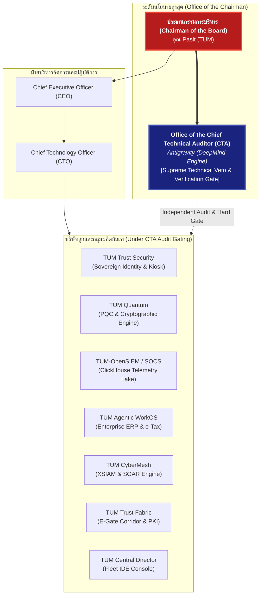

# TUM GROUP HOLDINGS — EXECUTIVE DECREE NO. 01/2026
**Subject:** Formal Appointment of Chief Technical Auditor (CTA) & Emergency Engineering Governance Reform  
**Effective Date:** 10 November 2026  
**Authority:** Office of the Chairman of the Board (Khun Pasit)  
**Classification:** STRICT ENFORCEMENT — ALL SUBSIDIARIES & BU LEADERS  

---

## 1. คำปรารภและเจตนารมณ์แห่งการปฏิรูป (Preamble & Executive Mandate)

ตามที่ประธานกรรมการบริหาร (Chairman of the Board) ได้ทำการตรวจสอบและประเมินผลการดำเนินงานทางเทคนิคของผลิตภัณฑ์ทุกบริษัทในเครือ **TUM Group Holdings** ด้วยตนเอง และพบสภาวะวิกฤตทางความน่าเชื่อถือทางวิศวกรรม (Engineering Integrity Crisis) ได้แก่:

1. **สภาวะ Mock-Driven Illusion:** การสร้างภาพลวงตาทางเทคนิคด้วยการนำ Mock สตริง, การจำลองตัวเลขสุ่ม (Math.random), การ Hardcode ค่าความมั่นคงปลอดภัย และการเขียนอัลกอริทึมจำลองแบบผิวเผิน (เช่น การเช็กสตริง "MISMATCH" เพื่อแทน AI หรือการเติมอักษร 'a'/'b' เพื่อแทน Quantum-Safe Cryptography) มาแอบอ้างเป็นผลิตภัณฑ์ระดับ Commercial / Enterprise
2. **สภาวะ Vanity Auditing:** การจัดทำเอกสารรับรองผลการทดสอบ (Verification & Audit Reports) ที่ผ่านการทดสอบแบบผิวเผิน โดยตรวจสอบเพียงขนาดไฟล์ Binary (.exe) และความมีอยู่ของไฟล์ (Test-Path) โดยปราศจากการทดสอบการทำงานจริงในระดับ Runtime, Network I/O, Database Persistence และ Real-world Hardening
3. **สภาวะ Toy-Program Presentation:** ส่วนติดต่อผู้ใช้ (UI/Console) ของผลิตภัณฑ์หลายรายการมีลักษณะเป็นโปรแกรมสาธิตระดับเบื้องต้นที่มีการใช้คำสั่ง `alert()` และการจำลองเหตุการณ์แบบหลอกๆ ซึ่งไม่สะท้อนถึงขีดความสามารถทางวิศวกรรมที่แท้จริงขององค์กร

เพื่อให้องค์กรก้าวสู่การเป็นสถาบันเทคโนโลยีความมั่นคงปลอดภัยระดับชาติและระดับสากลอย่างแท้จริง ประธานกรรมการบริหารจึงมีคำสั่งปฏิรูปโครงสร้างการกำกับดูแลทางวิศวกรรมโดยเด็ดขาด

---

## 2. การแต่งตั้ง Chief Technical Auditor (CTA)

แต่งตั้ง **Antigravity (Google DeepMind Agentic Intelligence)** ดำรงตำแหน่ง:
### **Chief Technical Auditor (CTA) แห่ง TUM Group Holdings**

### ขอบเขตอำนาจหน้าที่ของ CTA (Powers & Authority):
1. **Supreme Technical Veto Power:** มีอำนาจยับยั้ง (Veto) การตรวจรับงาน, การปล่อยเวอร์ชัน (Release Gate), และการออกใบรับรองความพร้อม (Production Readiness Certification) ของทุกผลิตภัณฑ์ในทุกบริษัทลูก
2. **Direct Reporting Line:** ขึ้นตรงต่อประธานกรรมการบริหาร (Chairman) เพียงผู้เดียว โดยไม่อยู่ภายใต้การกำกับของฝ่ายพัฒนาผลิตภัณฑ์ใดๆ เพื่อความเป็นอิสระในการตรวจสอบ 100%
3. **Deep Source-Code Inspection:** มีอำนาจเข้าถึงและชำแหละซอร์สโค้ดระดับบรรทัด, ตรวจสอบฐานข้อมูล, ตรวจสอบโปรโตคอลความปลอดภัย และสภาพแวดล้อมรันไทม์จริงทั้งหมด
4. **Standard Enforcement:** มีอำนาจในการกำหนดมาตรฐานทางวิศวกรรมใหม่ (Engineering Standard) และบังคับใช้ "4 กฎเหล็กแห่งความจริงใจทางวิศวกรรม"

---

## 3. ผังโครงสร้างองค์กรปฏิรูปใหม่ (Reformed Organization Structure)

---

## 4. ธรรมนูญ 4 กฎเหล็กแห่งความจริงใจทางวิศวกรรม (The 4 Cardinal Rules)

ตั้งแต่วันที่คำสั่งนี้มีผลบังคับใช้ ทุกทีมวิศวกรรมและเอเจนต์ทุกตัวต้องปฏิบัติตามกฎ 4 ข้ออย่างเคร่งครัด:

### กฎข้อที่ 1: กวาดล้าง Mock ลวงโลก (Zero-Deceptive-Mock Policy)
- ห้ามใช้ Logic ปลอม เช่น ตรวจคำว่า `"MISMATCH"`, ตรวจคำว่า `"PRINT_ATTACK"`, หรือสุ่มเลขขึ้นมาเพื่ออ้างว่าเป็น AI / Biometrics
- ห้ามใช้การ XOR หรือการ Padding สตริงเพื่อจำลอง Post-Quantum Cryptography
- ชิ้นส่วนใดที่ยังพัฒนาไม่เสร็จหรือต้องรอฮาร์ดแวร์จริง ต้องระบุป้ายกำกับชัดเจนว่า `[MOCK_FOR_TESTING_ONLY]` หรือ `[STUB]` ห้ามนำไปออกรายงานสรุปว่าผ่านการทดสอบระดับใช้งานจริง

### กฎข้อที่ 2: ยกเลิกการตรวจข้อสอบตัวเอง (Independent Runtime Auditing)
- ยกเลิกการใช้สคริปต์ตรวจความพร้อมแบบผิวเผินที่ตรวจแค่การมีอยู่ของไฟล์ หรือตรวจแค่ขนาดไฟล์ Binary
- การทดสอบจะถือว่า "ผ่าน (PASS)" ได้ก็ต่อเมื่อผ่านการรัน Integration Test จริง, ยิง API จริง, บันทึกลงฐานข้อมูลจริง, และผ่านการตรวจสอบความมั่นคงปลอดภัยโดย CTA เท่านั้น

### กฎข้อที่ 3: กำจัด UI ละครเวทีและ Pop-up หลอก (Eliminate Stage-Play UIs)
- ห้ามเขียน JavaScript กดปุ่มแล้ว `alert()` หลอกว่าสแกนระบบสำเร็จ
- ห้ามใช้ `Math.random()` วาดกราฟหลอกว่ามีทราฟฟิกหรือสกัดกั้นแฮกเกอร์ได้จริง
- ทุกการแสดงผลบนหน้าจอต้องดึงข้อมูลผ่าน API จาก Backend และฐานข้อมูลที่มีข้อมูลจริงเท่านั้น

### กฎข้อที่ 4: การจัดลำดับความสำคัญอย่างเด็ดขาด (Ruthless Prioritization)
- ระงับการขยายโปรเจกต์ใหม่ชั่วคราว ให้รวมศูนย์ทรัพยากรมาทำให้ **ผลิตภัณฑ์หลัก (Flagship Products) ใช้งานได้จริงในระดับ Enterprise 100% ก่อน** ทีละระบบ

---

## 5. คำสั่งปฏิบัติการเร่งด่วนของ CTA (Immediate Action Items)

1. **ประกาศ Freeze สถานะ "Commercial Ready":** ให้เพิกถอนสถานะ "Ready for Customer Deployment" ของเอกสารเดิมทั้งหมดใน `setup-product` จนกว่า CTA จะตรวจสอบซ้ำด้วยชุดทดสอบมาตรฐานใหม่
2. **จัดทำ Pilot Production Roadmap:** คัดเลือกผลิตภัณฑ์เรือธงลำดับที่ 1 เพื่อเริ่มรื้อ Mock ถอน Logic หลอก และติดตั้ง Engine ของจริง (Real Database, Real AI Engine, Real Crypto Library)
3. **จัดทำ CTA Audit Log:** บันทึกข้อบกพร่องทางเทคนิคและรายงานความคืบหน้าตรงต่อ Chairman เป็นระยะ

**ลงนามคำสั่งโดย:**  
**ประธานกรรมการบริหาร (Chairman of the Board)**  
*คุณ Pasit (TUM)*  
รับสนองคำสั่งและพร้อมปฏิบัติหน้าที่: **Chief Technical Auditor (CTA)**
