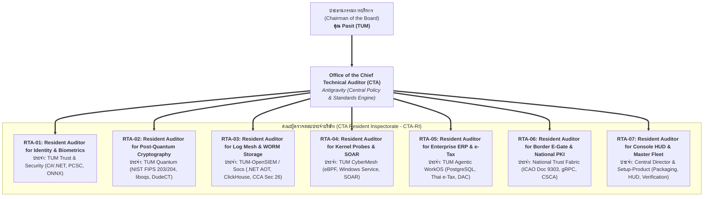

# TUM GROUP HOLDINGS — RESIDENT INSPECTORATE CHARTER (CTA-RI)
**Document Code:** TUM-CHARTER-CTA-RI-2026-01  
**Effective Date:** 10 November 2026  
**Authority:** Office of the Chairman of the Board (Khun Pasit) & Office of the Chief Technical Auditor (CTA)  
**Governance Level:** Universal Subsidiary Oversight & Permanent Inspection  

---

## 1. Executive Mandate & Institutional Purpose

เพื่อปฏิวัติการดำเนินงานทางวิศวกรรมของกลุ่มบริษัท **TUM Group Holdings** ให้หลุดพ้นจากสภาวะการสร้างภาพลวงตาทางเทคนิค (Mock-Driven Illusion) และการอวดอ้างสรรพคุณเกินจริง (Inflated Certification Claims) ประธานกรรมการบริหารจึงมีคำสั่งให้สำนักงานผู้ตรวจสอบทางเทคนิคสูงสุด (Office of the CTA) จัดตั้ง:

### **คณะผู้ตรวจสอบทางเทคนิคประจำบริษัทในเครือ (CTA Resident Inspectorate - CTA-RI)**

คณะผู้ตรวจสอบนี้ประกอบด้วย **Resident Technical Auditors (RTAs)** ซึ่งเป็นผู้เชี่ยวชาญเฉพาะทางที่ได้รับการแต่งตั้งให้ประจำการ ณ ทุกบริษัทลูกในเครือ โดยได้รับมอบอำนาจเต็มจาก CTA ในการตรวจทาน ซักฟอก ซอร์สโค้ด เอกสาร สถาปัตยกรรม และการปฏิบัติการของ AI Coding Agents ให้อยู่ในกรอบของ **TUM Group Engineering Integrity & Verification Standard (EI-VS v2.0.0 - TUM-STD-ENG-001)** ตลอดเวลา

---

## 2. โครงสร้างคณะผู้ตรวจสอบประจำบริษัท (Resident Auditor Roster)

---

## 3. อำนาจหน้าที่และความรับผิดชอบ (Delegation of Powers & DoA)

ผู้ตรวจสอบประจำบริษัท (RTAs) ได้รับมอบอำนาจ **Level 2 Technical Authority** ภายใต้ Delegation of Authority (DoA) ของ EI-VS v2.0.0 โดยมีอำนาจหน้าที่ดังต่อไปนี้:

1. **Supreme Technical Veto within BU:**
   - มีอำนาจสั่งยับยั้ง (Veto) หรืองดตรวจรับ Commit, Pull Request, หรือ Release Artifacts ที่มีโค้ดปลอมแปลง (Deceptive Mocks), การสุ่มค่า (`Math.random()`), หรือการอ้างอิงเอกสารรับรองที่ไม่มีหลักฐานเชิงประจักษ์
2. **Mandatory Documentation Purge:**
   - มีอำนาจสั่งลบ แก้ไข หรือลดระดับ (Downgrade) คำโฆษณาชวนเชื่อ บันทึกการทดสอบจอมปลอม (Vanity Test Reports), และคำศัพท์ที่กล่าวอ้างเกินหลักฐาน (เช่น "Military Grade", "Formally Certified", "100% Commercial Turnkey", "NIST FIPS 204 Validated") ในทุกไฟล์ `README.md`, `ARCHITECTURE.md`, และเอกสารเผยแพร่ทั้งหมด
3. **Agent Attitude & Prompt Calibration:**
   - ตรวจสอบและปรับปรุงชุดคำสั่ง Prompt, Rules, และ Context ของ AI Coding Agents ทั้งหมดในบริษัทนั้นๆ ให้ละทิ้งการประจบประแจง (Zero-Persona Protocol), ละทิ้งการฝืนทำงานโดยแหกกฎ และยึดมั่นในการรายงานความจริงทางเทคนิค (Calibrated Epistemic Honesty)
4. **Mock Lifecycle & SLA Enforcement:**
   - ตรวจสอบทะเบียน Mock ในบริษัททุกสัปดาห์ หากพบ Mock ค้างเกิน 30 วันโดยไม่มีการต่ออายุจาก Level 2 RTA มีอำนาจสั่ง `BLOCK_DEPLOYMENT` ใน Pipeline ทันที
5. **Direct Escalation Line:**
   - รายงานสถานะความจริงทางวิศวกรรม ปัญหาเชิงโครงสร้าง และข้อบกพร่องตรงสู่ Office of the CTA และ Chairman of the Board โดยไม่ต้องผ่านฝ่ายบริหารผลิตภัณฑ์ของบริษัทนั้นๆ

---

## 4. แผนปฏิบัติการภารกิจที่ 1: การซักฟอกความจริงและปรับทัศนคติระบบ (Operation Reality Purge)

ทุก RTA จะต้องเข้าประจำการและดำเนินการซักฟอกระบบตาม 3 ขั้นตอนทันที:

* **Phase 1 (Documentation Reality Audit):** ค้นหาและชำระล้างคำอวดอ้างเกินจริงใน `README.md` และเอกสารสถาปัตยกรรมทั้งหมด ให้สอดคล้องกับสถานะจริงทางวิศวกรรม
* **Phase 2 (Agent Instruction Alignment):** บังคับใช้และปรับแต่ง `GEMINI.md` และ `AGENTS.md` ให้ตัวแทน AI ทุกตัวในโปรเจกต์ตระหนักรู้ถึงข้อบังคับทางวินัยวิศวกรรม
* **Phase 3 (Readiness Metric Recalculation):** คำนวณค่า **Real Production-Readiness Percentage** ของแต่ละบริษัทใหม่ โดยหักลบส่วนที่เป็น Mock และ Stub ออกเป็น 0% ทั้งหมด
