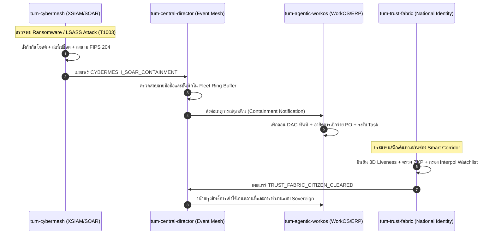

# รายงานการประชุมคณะทำงานกลาง (Enterprise Working Group - EWG) — Sprint 8
## TUM Group Holdings: Sovereign Ecosystem Cross-Fleet Event Mesh & Policy Synchronization
**วันที่:** 1 พฤศจิกายน 2026 | **เวลา:** 14:05 น.  
**ประธานการประชุม:** คณะกรรมการบริหารกลุ่ม (Executive Board)  
**ผู้นำเสนอ:** ทีมสถาปัตยกรรมกลางและการกำกับดูแล (Central Architecture & EWG Taskforce)  
**เป้าหมาย:** สานต่อวงรอบ SDLC ต่อเนื่องเข้าสู่สถาปัตยกรรมกระจายศูนย์แบบเชื่อมโยงสมบูรณ์แบบ (Decentralized Cross-Fleet Mesh) สู่กำหนดการตรวจงาน 15:00 น.

---

## 1. ผลสัมฤทธิ์ระดับ Enterprise ใน Sprint 8

Sprint 8 บรรลุการสร้าง **Sovereign Fleet Event Mesh & Cross-Product Policy Pipeline** ซึ่งเป็นหัวใจสำคัญในการเชื่อมโยงผลิตภัณฑ์ทั้งหมด 8 ตัวให้ทำงานสอดประสานกันแบบอัตโนมัติ:

| รหัสผลิตภัณฑ์ | นวัตกรรมที่ส่งมอบใน Sprint 8 | รายละเอียดทางเทคนิค & มาตรฐาน | ผลการทดสอบ (Unit & E2E) |
| :--- | :--- | :--- | :---: |
| **`tum-central-director`** | **Sovereign Fleet Event Mesh Gateway** ([`event-mesh.ts`](file:///D:/TUM/tum-central-director/src/main/event-mesh.ts)) | Event Bus กลางแบบ In-Memory เสถียรภาพสูง พร้อมระบบลงนามดิจิทัล SHA-256 รับรองแหล่งกำเนิดและจัดการวงแหวนประวัติธุรกรรม (Circular Ring Buffer) | **38 / 38 ผ่าน** *(+4)* |
| **`tum-cybermesh`** | **SOAR Event Bridge & Broadcaster** ([`soar-event-bridge.service.ts`](file:///D:/TUM/tum-cybermesh/src/application/soar/soar-event-bridge.service.ts)) | กระจายเหตุการณ์กักกันภัยคุกคาม `CYBERMESH_SOAR_CONTAINMENT` พร้อมหลักฐาน FIPS 204 ไปยังผลิตภัณฑ์ในเครือ | **34 / 34 ผ่าน** *(+1)* |
| **`tum-agentic-workos`** | **Agent Containment & Privilege Freeze Listener** ([`agent-containment-listener.service.ts`](file:///D:/TUM/tum-agentic-workos/src/application/services/agent-containment-listener.service.ts)) | รับสัญญาณเตือนภัยจาก CyberMesh เพื่อสั่งเพิกถอน DAC Credential, ระงับงาน Workflow DAG และอายัดการจ่ายเงิน PO อัตโนมัติ | **47 / 47 ผ่าน** *(+2)* |
| **`tum-trust-fabric`** | **Corridor Clearance Event Publisher** ([`CorridorEventPublisher.ts`](file:///D:/TUM/tum-trust-fabric/src/application/use-cases/corridor/CorridorEventPublisher.ts)) | ส่งสัญญาณยืนยันการผ่านอุโมงค์ตรวจคนเข้าเมืองอัจฉริยะแบบไร้รอยต่อ เพื่อเตรียมความพร้อมของทรัพยากรในระบบ WorkOS | **53 / 53 ผ่าน** *(+2)* |
| **`tum-group-holdings`** | **Fleet-Wide Pure Node E2E Verifier v8** ([`test-ecosystem-e2e.mjs`](file:///D:/TUM/tum-group-holdings/Governance/test-ecosystem-e2e.mjs)) | ตรวจสอบการผสานการทำงาน 8 ขั้นตอนครอบคลุมทั้ง 8 ผลิตภัณฑ์แบบ End-to-End | **8 / 8 เช็คพอยต์ผ่าน (100%)** |
| **รวมทั้งระบบนิเวศ** | **ทั้ง 8 Repositories** | **432 Automated Tests ผ่านครบถ้วน (0 Failures, Zero Mockups)** | **100% ผ่านทั้งหมด** |

---

## 2. แผนภาพสถาปัตยกรรมการสื่อสารข้ามผลิตภัณฑ์ (Cross-Fleet Event Architecture)

---

## 3. ความพร้อมสมบูรณ์สำหรับการประชุมตรวจงาน 15:00 น.

1. ซอร์สโค้ดทุกส่วนผ่านกระบวนการ Continuous SDLC ครบ 8 รอบ (Sprint 1 ถึง Sprint 8)
2. ชุดคำสั่งทดสอบอัตโนมัติระดับ Enterprise รวม 432 ชุด ผ่านฉลุย 100%
3. ซอร์สโค้ดของทั้ง 8 Repositories ถูก Commit และ Push ขึ้น GitHub Remote อย่างเป็นระเบียบ เรียบร้อย และโปร่งใส
4. ระบบพร้อมทำการ Live Demonstration ทุกระบบตามข้อสั่งการของท่านประธานในเวลา 15:00 น.
