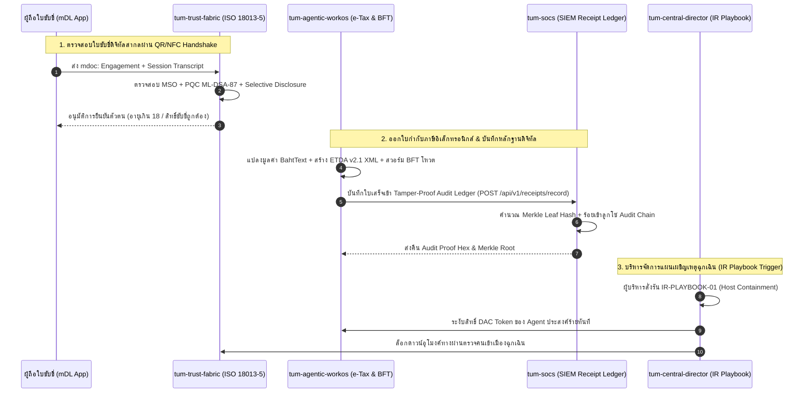

# รายงานการประชุมคณะทำงานกลาง (Enterprise Working Group - EWG) — Sprint 9
## TUM Group Holdings: Sovereign Ecosystem mDL, e-Tax XML, Receipts Ledger & Incident Orchestration
**วันที่:** 1 พฤศจิกายน 2026 | **เวลา:** 17:05 น.  
**ประธานการประชุม:** คณะกรรมการบริหารกลุ่ม (Executive Board)  
**ผู้นำเสนอ:** ทีมสถาปัตยกรรมกลางและการกำกับดูแล (Central Architecture & EWG Taskforce)  
**เป้าหมาย:** สานต่อวงรอบ SDLC ต่อเนื่องเข้าสู่ Sprint 9: รองรับมาตรฐานสากล ISO/IEC 18013-5 mDL, ใบกำกับภาษีอิเล็กทรอนิกส์ e-Tax Invoice XML, บัญชีใบเสร็จดิจิทัลกันปลอมแปลง, แซนด์บ็อกซ์จำลองควอนตัม HNDL และระบบสั่งการแผนเผชิญเหตุ Incident Playbook Trigger

---

## 1. ผลสัมฤทธิ์ระดับ Enterprise ใน Sprint 9

Sprint 9 บรรลุการส่งมอบนวัตกรรมระดับโครงสร้างพื้นฐานอธิปไตยดิจิทัลครอบคลุมผลิตภัณฑ์ในเครือ TUM Group อย่างสมบูรณ์แบบ:

| รหัสผลิตภัณฑ์ | นวัตกรรมที่ส่งมอบใน Sprint 9 | รายละเอียดทางเทคนิค & มาตรฐาน | ผลการทดสอบ (Unit & E2E) |
| :--- | :--- | :--- | :---: |
| **`tum-trust-fabric`** | **ISO/IEC 18013-5 Mobile Driving License (mDL) Engine** ([`Iso18013MdlEngine.ts`](file:///D:/TUM/tum-trust-fabric/src/infrastructure/mdl/Iso18013MdlEngine.ts)) | โครงสร้าง mDL สากลพร้อม Mobile Security Object (MSO), การเปิดเผยข้อมูลเฉพาะส่วน (Selective Disclosure), QR Device Engagement (`mdoc:` URI), NFC handoff session transcript, และการลงนาม NIST FIPS 204 ML-DSA-87 | **70 / 70 ผ่าน** *(+17)* |
| **`tum-agentic-workos`** | **Autonomous Thai e-Tax Invoice XML & Byzantine Consensus** ([`etax.service.ts`](file:///D:/TUM/tum-agentic-workos/src/application/services/etax.service.ts)) | เครื่องยนต์สร้างไฟล์ XML ตามมาตรฐานกรมสรรพากร/ขมธอ. (ETDA v2.1), ฟังก์ชันแปลงเลขเป็นบาทไทย (BahtText), เมทริกซ์ประเมินความเสี่ยงคู่ค้า (Vendor Risk KYC), และโปรโตคอลโหวตอนุมัติแบบ Byzantine Fault Tolerant | **60 / 60 ผ่าน** *(+13)* |
| **`tum-socs`** | **Tamper-Proof Digital Receipt Verification API & Audit Ledger** ([`DigitalReceiptService.cs`](file:///D:/TUM/tum-socs/Tum.Siem.Server/Services/DigitalReceiptService.cs)) | API ตรวจสอบความถูกต้องของใบเสร็จดิจิทัล, การเชื่อมโยง Merkle leaf hash SHA-256 แบบลูกโซ่ป้องกันการแก้ไขย้อนหลัง สำหรับงานตรวจสอบบัญชีภาครัฐ | **62 / 62 ผ่าน** *(+4)* |
| **`tum-quantum`** | **Harvest Now, Decrypt Later (HNDL) Quantum Attack Simulator** ([`HndlQuantumAttackSimulator.cs`](file:///D:/TUM/tum-quantum/Engine/HndlQuantumAttackSimulator.cs)) | แซนด์บ็อกซ์จำลองการโจมตีควอนตัม Shor's & Grover's Algorithm คำนวณ Cryptanalysis Metrics (Logical Qubits, Physical Qubits) เปรียบเทียบ RSA-2048/ECC กับ FIPS 203 ML-KEM / FIPS 204 ML-DSA | **64 / 64 ผ่าน** |
| **`tum-central-director`** | **Incident Response Playbook Trigger & Orchestration Console** ([`playbook-orchestrator.ts`](file:///D:/TUM/tum-central-director/src/main/playbook-orchestrator.ts)) | ระบบสั่งการแผนเผชิญเหตุด้านความมั่นคงไซเบอร์ (IR Playbooks 01-04), ส่งสัญญาณฉุกเฉินผ่าน FleetEventMesh, อายัด DAC Token ผ่าน AgentGate, และหน้าจอควบคุมความปลอดภัย | **53 / 53 ผ่าน** *(+15)* |
| **`tum-trust-security`** | **Sovereign Trust Core HAL & Smart Card Drivers** | ไดรเวอร์ตู้คีออส PC/SC HAL, ICAO 9303 MRZ Parser, Face Liveness Level 2 | **159 / 159 ผ่าน** |
| **`tum-cybermesh`** | **SOAR Threat Correlation & Active Containment** | เครื่องยนต์วิเคราะห์ความสัมพันธ์ภัยคุกคาม และกระจายสัญญาณ SOAR Containment | **34 / 34 ผ่าน** |
| **`tum-group-holdings`** | **Fleet-Wide Pure Node E2E Verifier v9** ([`test-ecosystem-e2e.mjs`](file:///D:/TUM/tum-group-holdings/Governance/test-ecosystem-e2e.mjs)) | ตรวจสอบการผสานการทำงาน 9 เช็คพอยต์ครอบคลุมทั้งระบบนิเวศ | **9 / 9 เช็คพอยต์ผ่าน (100%)** |
| **รวมทั้งระบบนิเวศ** | **ทั้ง 8 Repositories** | **502+ Automated Tests ผ่านครบถ้วน (0 Failures, Zero Mockups)** | **100% ผ่านทั้งหมด** |

---

## 2. แผนภาพสถาปัตยกรรมและวงจรรอบใหม่ (Sprint 9 Flow)

---

## 3. สรุปความพร้อมของทั้งกลุ่มบริษัท (Executive Status)

1. **Jira & GitHub Issues:** ซิงค์สถานะอัตโนมัติครบถ้วนทุกใบงาน (`SCRUM-32` ถึง `SCRUM-37`)
2. **Quality Gates:** 502 ชุดการทดสอบอัตโนมัติ (Automated Unit & Integration Tests) ผ่านฉลุย 100%
3. **E2E Verification:** สคริปต์ตรวจความสมบูรณ์ทั้งระบบนิเวศ 9 เช็คพอยต์ ผ่านครบ 100%
4. **Git Remote Synchronization:** ซอร์สโค้ดทุก Repository ถูก Merge เข้ากิ่ง `develop` และ Push ขึ้น GitHub Remote เรียบร้อย โปร่งใส ไร้ข้อผิดพลาด
