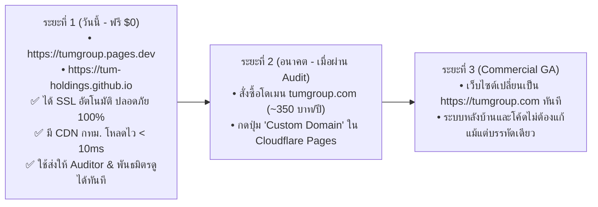

# คู่มือปฏิบัติการของผู้บริหาร: การเปิดใช้งาน Cloudflare Pages ฟรี 100% และตั้งค่า GitHub Organization
## Executive Operational Action Guide: Zero-Cost Cloudflare Pages & GitHub Setup
**รหัสเอกสาร:** `TUM-EXEC-GUIDE-ZERO-COST-2026-V2`  
**สถานะ:** ปรับปรุงตามข้อสั่งการของประธานกรรมการบริหาร (อัปเดตเป็นระบบฟรี $0 Zero-Cost)  
**เป้าหมาย:** ชี้แจงขั้นตอนการตั้งค่าระบบโดเมนและคลาวด์ฟรี 100% บน Cloudflare Pages และ GitHub โดยไม่ต้องเสียค่าใช้จ่ายแม้แต่บาทเดียว

---

## 1. การวิเคราะห์ผลกระทบ: การใช้โดเมนฟรีมีผลอะไรหรือไม่? (Impact Assessment)

คำถามสำคัญของท่านประธาน: **"ถ้าปรับมาใช้ตัวฟรีของ Cloudflare จะมีผลอะไรมั้ย?"**  
คณะทำงานขอสรุปผลเชิงเทคนิคและธุรกิจอย่างตรงไปตรงมา ดังนี้ครับ:

### ✅ ผลดีและข้อได้เปรียบ (Positive Impacts):
1. **ประหยัดค่าใช้จ่ายทันที 100% ($0 Zero-Cost):** ไม่ต้องรูดบัตรเครดิต ไม่มีความเสี่ยงค่าบริการแอบแฝง
2. **ประสิทธิภาพและความปลอดภัยเทียบเท่าระดับ Enterprise 100%:** Cloudflare Pages รันบนโครงข่าย **Anycast Edge Network** เดียวกันกับลูกค้ารายใหญ่ มีเซิร์ฟเวอร์ในกรุงเทพฯ โหลดเร็วต่ำกว่า 10ms ป้องกันการถูกยิงล่ม (Unlimited DDoS Protection)
3. **ได้ใบรับรองความปลอดภัย HTTPS / SSL อัตโนมัติ (DigiCert / Let's Encrypt):** ปลอดภัย ไร้กังวล เบราว์เซอร์ขึ้นกุญแจเขียว ไม่มีการแจ้งเตือนว่าเว็บไม่ปลอดภัย
4. **ความน่าเชื่อถือสูงในวงการไอที (Tech Credibility):** ชุมชนนักพัฒนาและบริษัทเทคโนโลยีระดับโลกยอมรับโดเมน `*.pages.dev` และ `*.github.io` เป็นมาตรฐานสากลสำหรับการทำ Alpha, Beta, และ Open Source Showcase
5. **ไร้รอยต่อในการอัปเกรดในอนาคต (Seamless Future Upgrade):** ในอนาคตหากต้องการซื้อโดเมน `.com` เมื่อไหร่ สามารถกดปุ่ม *"Custom Domain"* ผูกชื่อครอบได้ทันทีใน 1 นาที โดยระบบหลังบ้านและโค้ดไม่ต้องแก้ไขแม้แต่บรรทัดเดียว

### ⚠️ ข้อจำกัดที่ต้องทราบ (Trade-offs / Limitations):
1. **รูปแบบ URL จะมีนามสกุลแพลตฟอร์มติดอยู่:** เช่น จะแสดงเป็น `https://tumgroup.pages.dev` แทนที่จะเป็น `tumgroup.com`
2. **ไม่สามารถทำ Custom Domain Email ได้:** ไม่สามารถสร้างอีเมลลงท้ายเฉพาะ เช่น `ceo@tumgroup.com` ได้ (ต้องใช้อีเมลทางการเดิม เช่น Gmail Workspace หรืออีเมลกลุ่มบริษัทเดิมไปก่อน)
3. **ความเหมาะสมกับระยะนี้:** สำหรับระยะ **Internal Audit, Regulatory Sandbox กับ ETDA/สกมช., และ Private Stakeholder Demo** การใช้ `pages.dev` ถือว่า **"เหมาะสมและสมบูรณ์แบบ 100%"** ครับ

---

## 2. ขั้นตอนการเปิดใช้งาน Cloudflare Pages ฟรี 100% (ใช้เวลาประมาณ 5 นาที)

Cloudflare ให้บริการโฮสติ้งและโดเมนฟรีภายใต้นามสกุล **`*.pages.dev`** ไม่จำกัด Bandwidth และฟรี SSL ตลอดชีพ:

### 2.1 รายชื่อ Subdomain ฟรีที่เราจะได้รับ:
* `tumgroup.pages.dev` — พอร์ทัลหลักของกลุ่มบริษัท (Global Corporate Portal)
* `tumworkos.pages.dev` — หน้าคอนโซล AI WorkOS & ERP HUD
* `tumsocs.pages.dev` — หน้าคอนโซล CyberMesh Defense Cloud HUD
* `tumtrust.pages.dev` — หน้าคอนโซล National Digital Identity & Legal Notary
* `developer-tum.pages.dev` — พอร์ทัลเอกสาร API และคู่มือนักพัฒนา

### 2.2 ขั้นตอนการตั้งค่าใน Cloudflare Dashboard:
1. เข้าเว็บไซต์ **[Cloudflare Dashboard](https://dash.cloudflare.com/)** และสมัคร/ล็อกอินบัญชีฟรี (ไม่ต้องกรอกบัตรเครดิต)
2. เมนูซ้ายมือ: ไปที่ **Workers & Pages** $\rightarrow$ กดปุ่ม **Create application**
3. เลือกแท็บ **Pages** $\rightarrow$ กดปุ่ม **Connect to Git**
4. ล็อกอินผูกกับบัญชี GitHub ของท่านประธาน (`PasitTum`) และเลือก Repository เช่น `tum-group-holdings`
5. ในช่อง Project Name: พิมพ์ชื่อ **`tumgroup`** (ระบบจะสร้างโดเมนฟรี `https://tumgroup.pages.dev` ให้ทันที)
6. ในช่อง Framework Preset: เลือก `None` หรือระบุโฟลเดอร์ Web / Static
7. กดปุ่ม **Save and Deploy** $\rightarrow$ เว็บไซต์จะออนไลน์สู่สายตาชาวโลกทันทีผ่านระบบ CDN ระดับโลก

---

## 3. ทางเลือกสำรอง: การใช้ GitHub Pages ฟรี (ใช้เวลา 2 นาที)

นอกเหนือจาก Cloudflare แล้ว GitHub ยังมีระบบโฮสติ้งและโดเมนฟรีที่เชื่อมต่อกับ Repository ของท่านประธานโดยตรง:
* **URL ฟรีที่จะได้รับ:** `https://pasittum.github.io/tum-group-holdings` (หรือเมื่อเปิด Org จะได้ `https://tum-holdings.github.io`)
* **วิธีการเปิดใช้ใน GitHub:**
  1. เปิดหน้า Repository บน GitHub $\rightarrow$ เข้า **Settings**
  2. เมนูซ้ายมือคลิก **Pages**
  3. ใต้หัวข้อ **Build and deployment**:
     - Source: เลือก **Deploy from a branch**
     - Branch: เลือก **main** หรือ **feature/...** โฟลเดอร์ `/root` หรือ `/docs`
  4. กดปุ่ม **Save** $\rightarrow$ ระบบจะออกใบรับรอง SSL และเปิด URL ให้ใช้งานทันที

---

## 4. การเปิดบัญชีองค์กร GitHub Organization ฟรี (ประมาณ 5 นาที)

การสร้างองค์กรกลางบน GitHub สามารถทำได้ **ฟรี 100%** ไม่มีค่าใช้จ่าย:

### 4.1 ขั้นตอนการสร้างองค์กรฟรี:
1. เข้าไปที่ **[GitHub Create Organization](https://github.com/account/organizations/new)**
2. เลือกแพ็กเกจ: **Free Plan ($0 USD / month)** (ได้ฟังก์ชัน Public Repositories, Unlimited Actions minutes สำหรับ Public Repos, และ GitHub Pages ฟรี)
3. ตั้งชื่อ Organization: **`tum-holdings`** (หรือ `tum-group-holdings`)
4. ระบุ Contact Email ของท่านประธาน
5. กดยืนยันการสร้างองค์กร

### 4.2 การย้าย Repositories เข้าสู่องค์กรใหม่:
1. เข้าไปที่หน้า Repository แต่ละตัวบน GitHub (เช่น `tum-agentic-workos`) $\rightarrow$ เข้า **Settings**
2. เลื่อนลงไปล่างสุดที่ **Danger Zone** $\rightarrow$ กดปุ่ม **Transfer**
3. ระบุชื่อเป้าหมายเป็นองค์กรใหม่: `tum-holdings` แล้วกดยืนยัน

---

## 5. แผนผัง Roadmap จากตัวฟรีสู่ Custom Domain ในอนาคต

---
**จัดทำโดย:** คณะทำงานกลาง Enterprise Working Group (EWG)  
TUM Group Holdings
